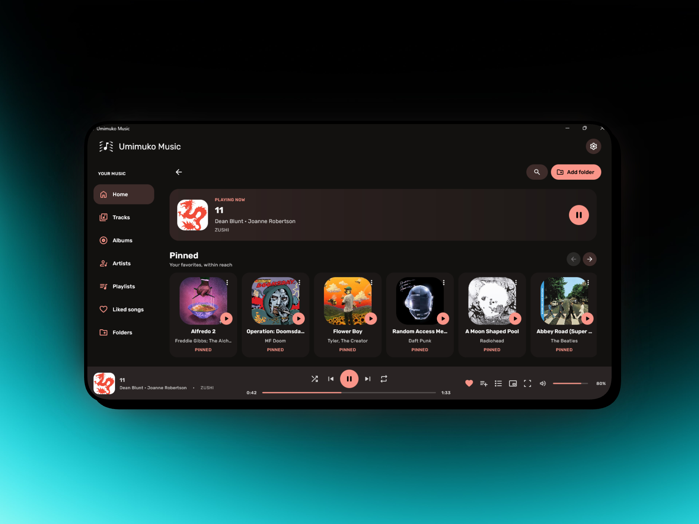
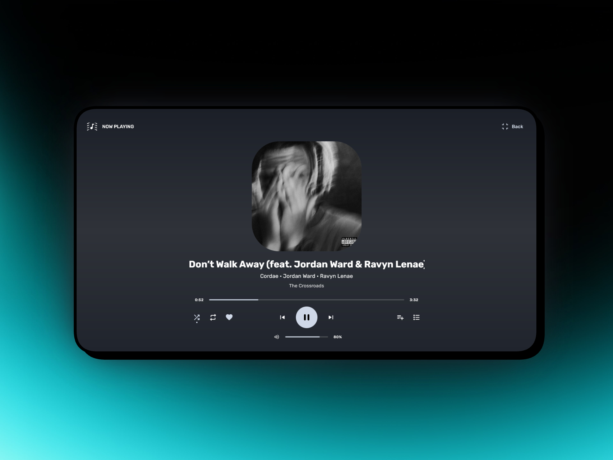
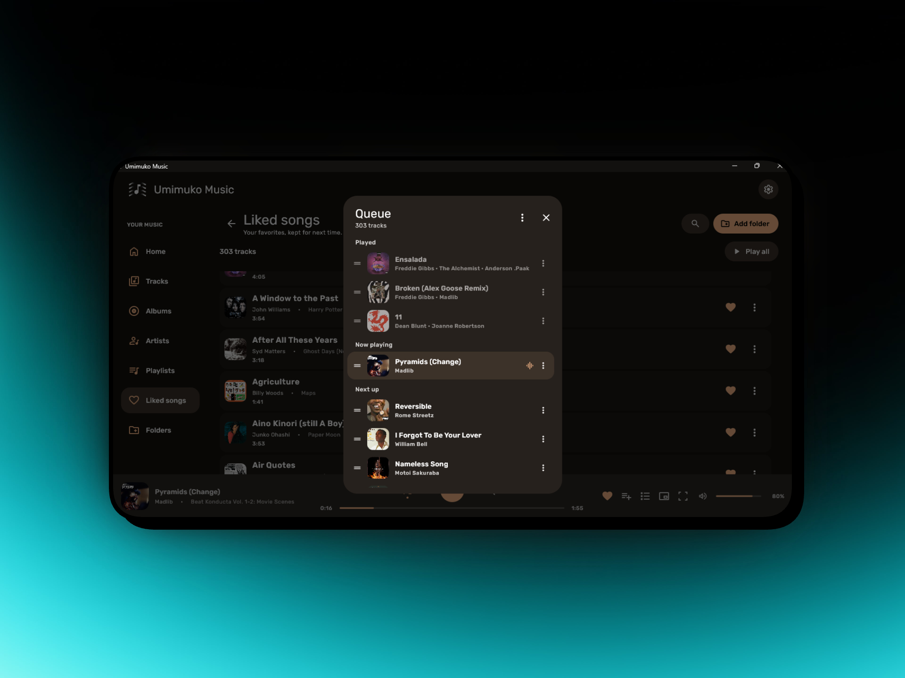
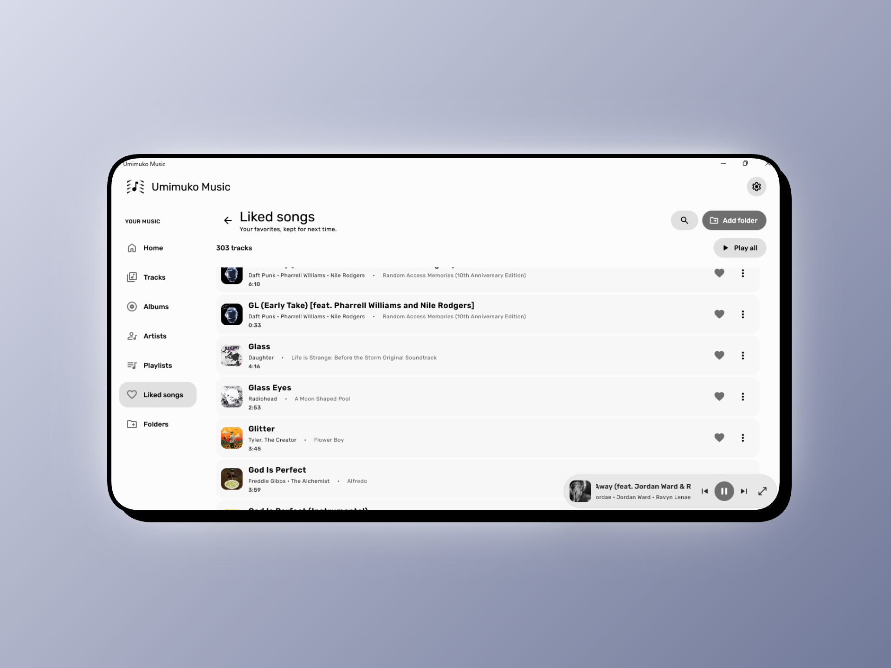

<div align="center">


# Umimuko Music

**پلیر موسیقی تمیز و آفلاین برای ویندوز — بدون استریمینگ، بدون اکانت، فقط موسیقی شما.**

[](https://github.com/real-Phraser/umimuko-music/releases)
[](https://github.com/real-Phraser/umimuko-music/releases)
[](https://kotlinlang.org)
[](LICENSE)

</div>

---

## ✨ ویژگی‌ها

- 🎵 پشتیبانی از MP3، FLAC، AAC، OGG، WAV و بیشتر
- 📁 سازمان‌دهی بر اساس آلبوم، هنرمند، پلی‌لیست و پوشه
- 🏠 صفحه‌ی خانه با قفسه‌های پین‌شده، اخیراً پخش‌شده و اخیراً اضافه‌شده
- 🎬 صفحه‌ی فول‌اسکرین با انتقال fade
- 🪟 مینی‌پلیر شناور روی همه‌ی پنجره‌ها
- 🌙 دارک و لایت مود
- 🎨 رنگ accent پویا از روی کاور آلبوم
- 📋 صف پخش با قابلیت کشیدن و انتخاب چندتایی
- ❤️ آهنگ‌های موردعلاقه، پلی‌لیست، جستجو، شافل و ریپیت

---

## 📸 اسکرین‌شات‌ها

<div align="center">

| خانه | در حال پخش |
|:---:|:---:|
|  |  |

| صف پخش | مینی‌پلیر / لایت مود |
|:---:|:---:|
|  |  |

</div>

---

## 🛒 دانلود

به صفحه‌ی **[Releases](https://github.com/real-Phraser/umimuko-music/releases)** برو و آخرین نسخه‌ی `.msi` رو دانلود کن.

**پیش‌نیازها:** ویندوز ۱۰ نسخه‌ی ۶۴ بیتی به بالا

---

## 🛠️ ساخت از سورس

نیاز به JDK 17 نسخه‌ی ۶۴ بیتی داری.

```bash
# اجرای مستقیم
.\gradlew.bat run

# ساخت نصب‌کننده (.exe / .msi)
.\gradlew.bat packageDistributionForCurrentOS
```

---

## 🔧 ساخته‌شده با

- [Kotlin 2.2](https://kotlinlang.org) + [Compose Desktop 1.9](https://www.jetbrains.com/lp/compose-multiplatform/)
- [Material 3](https://m3.material.io/)
- [JAudioTagger](https://www.jthink.net/jaudiotagger/)
- [JNA](https://github.com/java-native-access/jna)

---

## 📄 لایسنس

این پروژه تحت شرایط فایل [LICENSE](LICENSE) منتشر شده.

---

<div align="center">

ساخته‌شده توسط **[Phraser](https://github.com/real-Phraser)**

تشکر ویژه از **[Genie](https://github.com/actually-genius)** و **[Ari](https://github.com/itsarian)**

[](https://t.me/theCodePhraser)
[](https://github.com/real-Phraser)

</div>
