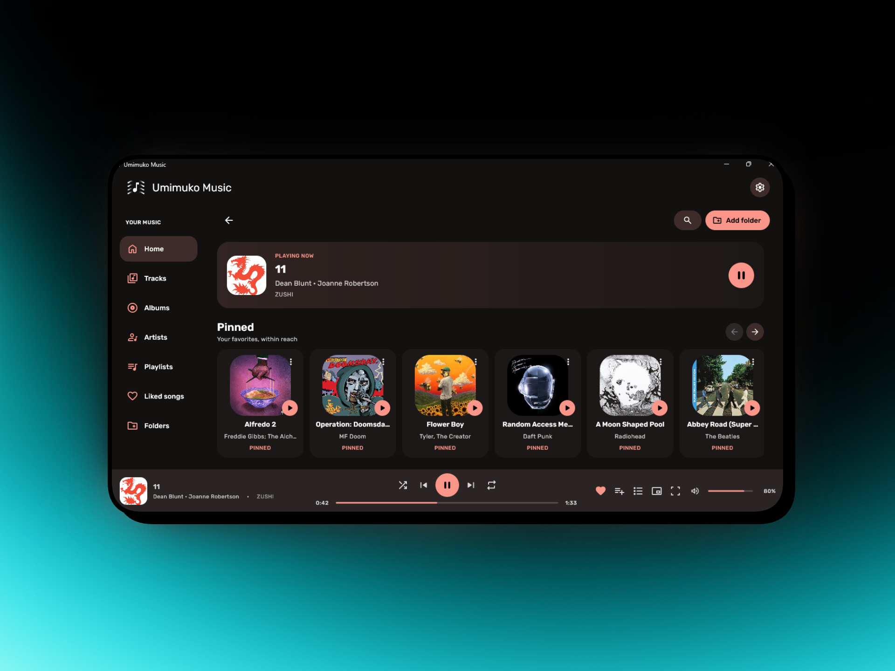
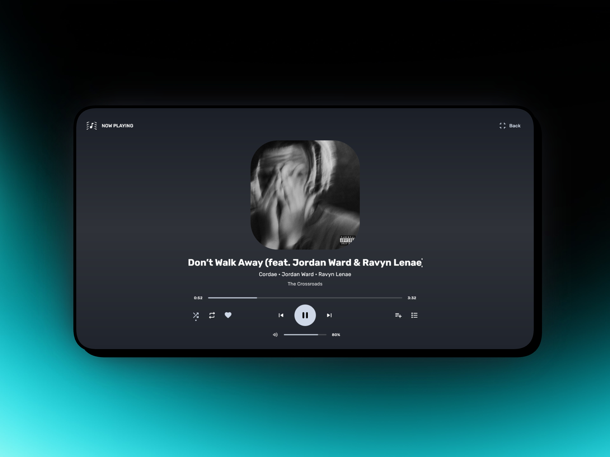
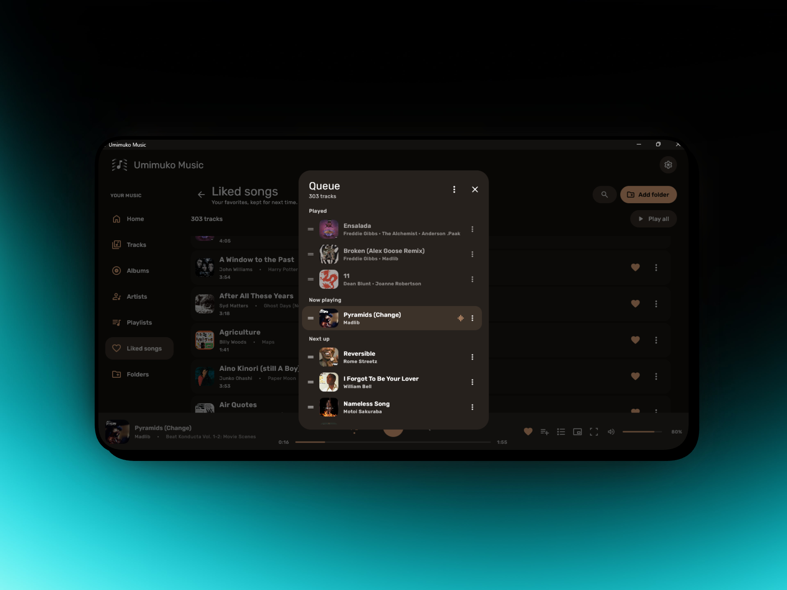
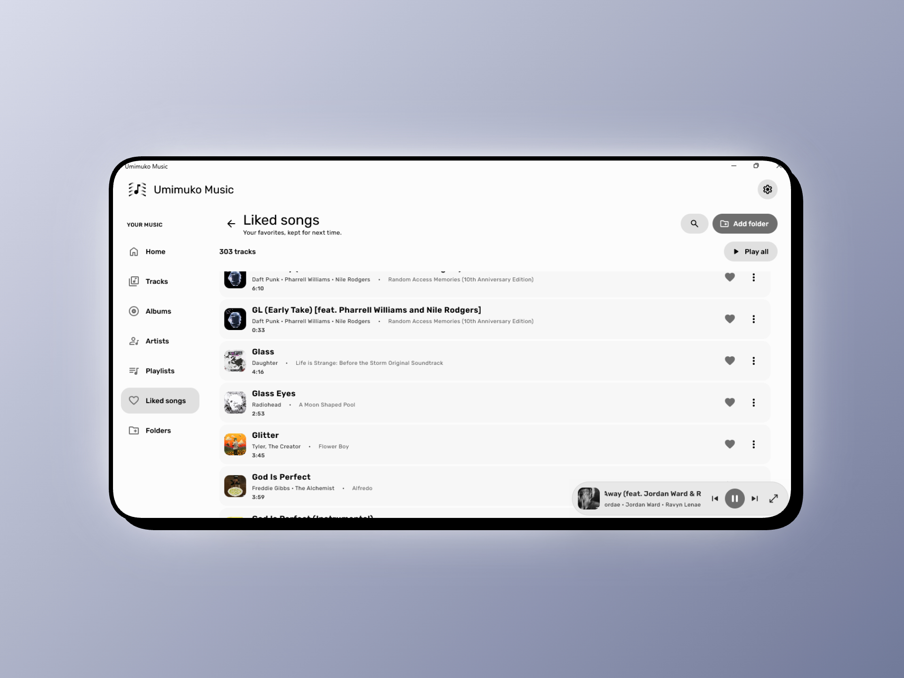

<div align="left">

[ فارسی](README-FA.md)

</div>


<div align="center">


# Umimuko Music

**A clean, offline-first music player for Windows, macOS, and Linux — no streaming, no accounts, just your music.**

[](https://github.com/real-Phraser/umimuko-music/releases)   
[](https://github.com/real-Phraser/umimuko-music/releases)
[](https://github.com/real-Phraser/umimuko-music/releases)
[](https://github.com/real-Phraser/umimuko-music/releases)
---------
[](https://github.com/real-Phraser/umimuko-music/actions/workflows/ci.yml)
[](https://kotlinlang.org)
[](LICENSE)

</div>

---

## ✨ Features

- 🎵 Plays MP3, FLAC, AAC, OGG, WAV and more
- 📁 Organizes by Albums, Artists, Playlists and Folders
- 🏠 Home with Pinned, Recently played and Recently added shelves
- 🪟 Floating mini player that stays on top
- 🌙 Dark and Light mode
- 🎨 Album color accent that follows the cover art
- 📋 Playback queue with drag-to-reorder and multi-select
- ❤️ Liked songs, playlists, search, shuffle and repeat

---

## 📸 Screenshots

<div align="center">

| Home | Now Playing |
|:---:|:---:|
|  |  |

| Queue | Mini Player / Light Mode |
|:---:|:---:|
|  |  |

</div>

---

## 🛒 Download

Go to the **[Releases](https://github.com/real-Phraser/umimuko-music/releases)** page and download the package for your operating system and architecture:
- **Windows** (x64, ARM64): `.msi` or `.exe` installer (bundled with VLC audio engine).
- **macOS** (Apple Silicon `arm64`): `.dmg` package (requires VLC 3.x, available via `brew install --cask vlc` or [videolan.org](https://www.videolan.org)).
- **Linux** (`x86_64`, `aarch64`): `.deb`, `.rpm`, or Arch Linux `.pkg.tar.zst` (requires system `vlc` package).

---

## 🛠️ Build from source

JDK 17 is required.

### macOS & Linux
Supports macOS (Apple Silicon `arm64`) and Linux (`x86_64` and `aarch64`).
```bash
# Run directly
./gradlew run

# Build portable application
./BUILD-PORTABLE.sh

# Build installer package for current OS (.dmg on macOS, .deb/.rpm on Linux)
./BUILD-INSTALLERS.sh

# Build Arch Linux package (.pkg.tar.zst)
./gradlew packageArchLinux
```

### Windows
Supports both 64-bit Windows architectures (x64 and ARM64).
```cmd
# Run directly
.\gradlew.bat run

# Build portable application
.\BUILD-PORTABLE.cmd

# Build installer (.exe / .msi)
.\BUILD-INSTALLERS.cmd
```

> **Note for Windows developers:** Building standalone Windows distributions requires VLC 3.x (64-bit x64 or ARM64). The build script automatically attempts to download it, or you can provide it manually via `-PvlcDir=...` or the `UMIMUKO_VLC_DIR` environment variable. See [docs/README-VLC-Setup.md](docs/README-VLC-Setup.md) for details.

---

## 🔧 Built with

- [Kotlin 2.2](https://kotlinlang.org) + [Compose Desktop 1.9](https://www.jetbrains.com/lp/compose-multiplatform/)
- [Material 3](https://m3.material.io/) design system
- [JAudioTagger](https://www.jthink.net/jaudiotagger/) for tag reading
- [vlcj](https://github.com/caprica/vlcj) + VLC 3 for high-fidelity audio playback
- Native media integrations: WinRT SMTC (Windows), MPRemoteCommandCenter (macOS), MPRIS2 (Linux)

---

## 📄 License

This project is licensed under the terms of the [LICENSE](LICENSE) file.

---

<div align="center">

Made by **[Phraser](https://github.com/real-Phraser)**

Special thanks to **[Genie](https://github.com/actually-genius)** & **[Ari](https://github.com/itsarian)**

[](https://t.me/theCodePhraser)
[](https://github.com/real-Phraser)

</div>
