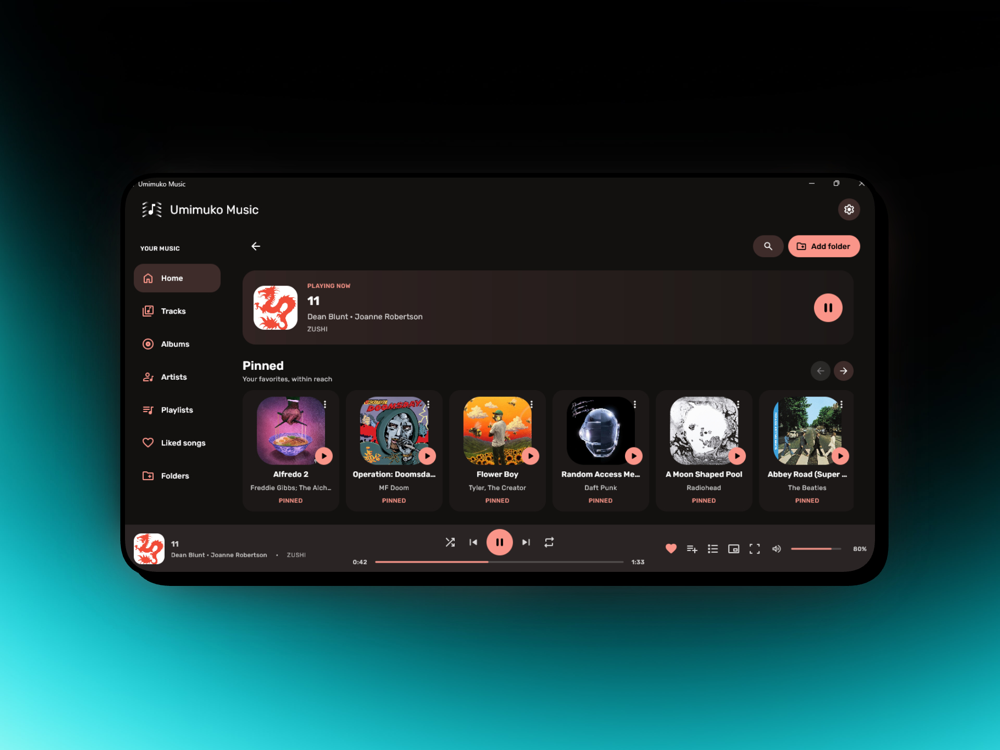
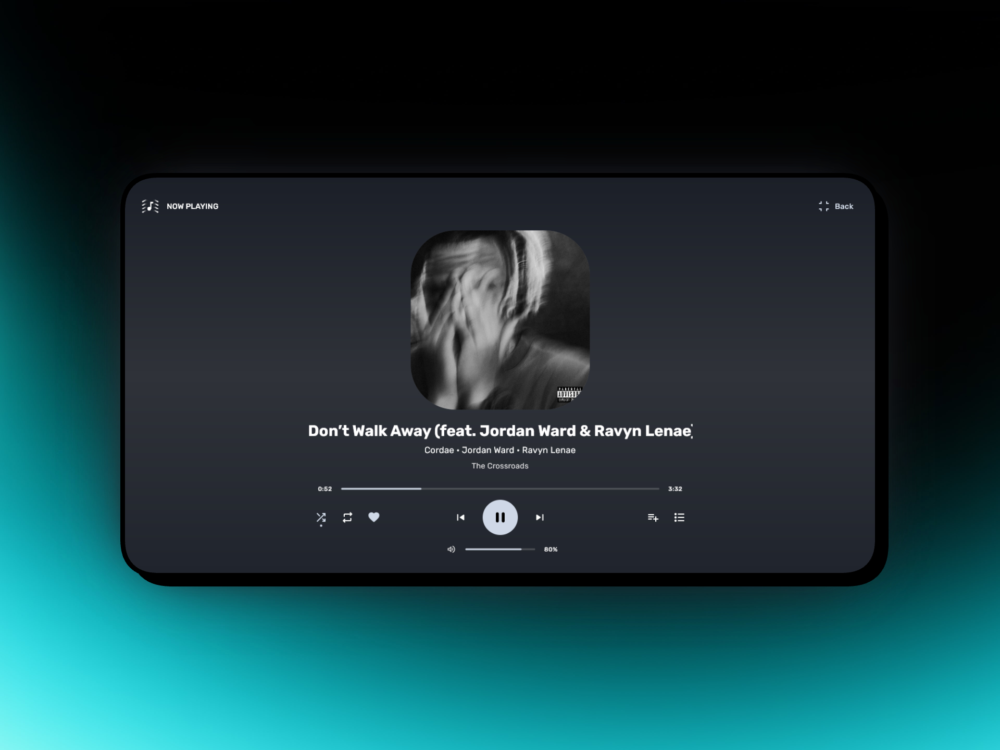
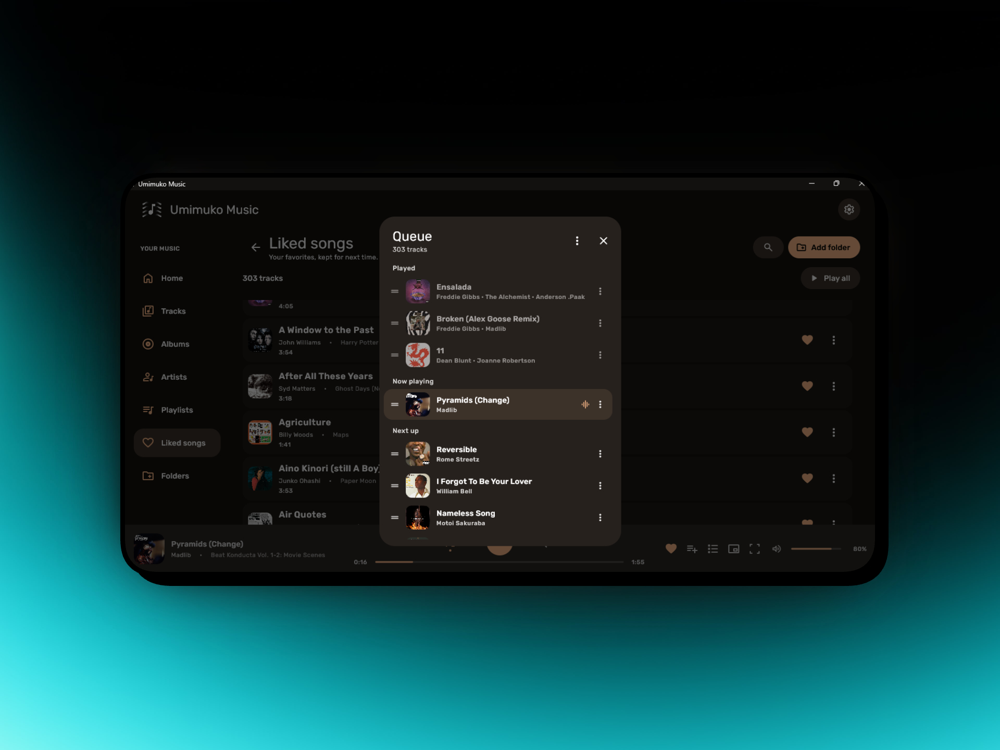
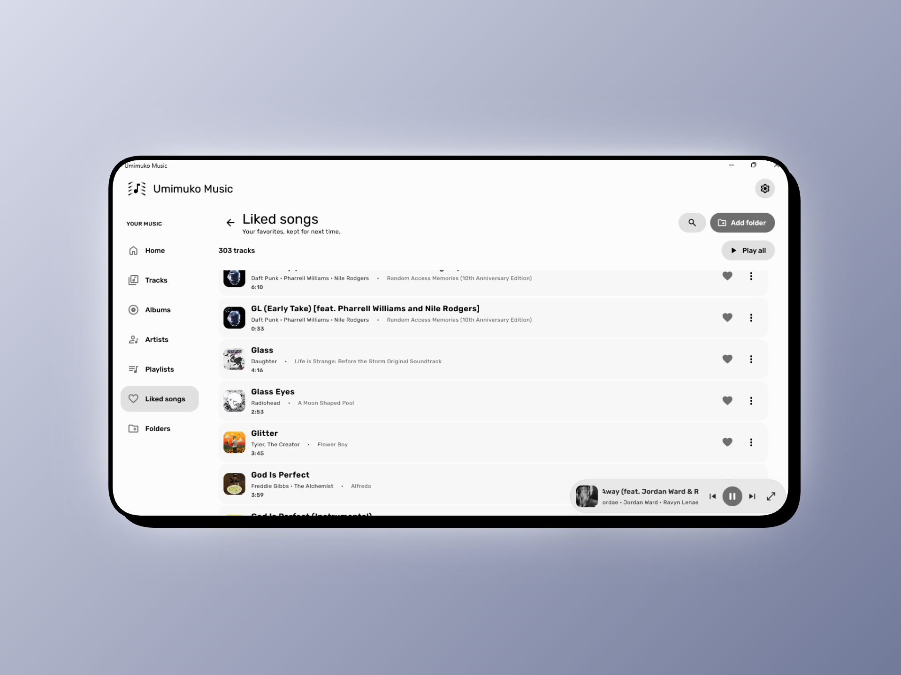

<div align="center">



# Umimuko Music

**A clean, offline-first music player for Windows — no streaming, no accounts, just your music.**

پلیر موسیقی تمیز و آفلاین برای ویندوز، بدون استریمینگ، بدون اکانت، فقط موسیقی شما.

[](https://github.com/real-Phraser/umimuko-music/releases)
[](https://github.com/real-Phraser/umimuko-music/releases)
[](https://kotlinlang.org)
[](LICENSE)

---

<!-- Replace with your screenshots -->


</div>

---

## ✨ Features / ویژگی‌ها

| | English | فارسی |
|---|---|---|
| 🎵 | Plays MP3, FLAC, AAC, OGG, WAV and more | پشتیبانی از فرمت‌های صوتی مختلف |
| 📁 | Organizes by Albums, Artists, Playlists and Folders | سازمان‌دهی بر اساس آلبوم، هنرمند، پلی‌لیست و پوشه |
| 🏠 | Home with Pinned, Recently played and Recently added shelves | صفحه‌ی خانه با قفسه‌های پین‌شده، اخیراً پخش‌شده و اخیراً اضافه‌شده |
| 🎬 | Full-screen now playing with fade transition | صفحه‌ی فول‌اسکرین با انتقال fade |
| 🪟 | Floating mini player that stays on top | مینی‌پلیر شناور روی همه‌ی پنجره‌ها |
| 🌙 | Dark and Light mode | دارک و لایت مود  |
| 🎨 | Album color accent that follows the cover art | رنگ پویا از روی کاور آلبوم |
| 📋 | Playback queue with drag-to-reorder and multi-select | صف پخش با قابلیت کشیدن و انتخاب چندتایی |
| ❤️ | Liked songs, playlists, search, shuffle and repeat | آهنگ‌های موردعلاقه، پلی‌لیست، جستجو، شافل و ریپیت |

---

## 📸 Screenshots / اسکرین‌شات‌ها


<div align="center">

| Home | Now Playing |
|:---:|:---:|
|  |  |

| Queue | Mini Player/Light Mode |
|:---:|:---:|
|  |  |

</div>

---

## 🛒 Download / دانلود

Go to the **[Releases](https://github.com/real-Phraser/umimuko-music/releases)** page and download one of:

به صفحه‌ی **[Releases](https://github.com/real-Phraser/umimuko-music/releases)** برو و یکی از موارد زیر رو دانلود کن:

| Package | Description |
|---|---|
| `Umimuko-Music.msi` | MSI installer for Windows / نصب‌کننده‌ی ویندوز |

**System requirements / پیش‌نیازها:** Windows 10 x64 or later / ویندوز ۱۰ به بالا

---

## 🛠️ Build from source / ساخت از سورس

```bash
# Windows — JDK 17 x64 required / نیاز به JDK 17 x64

# Run directly
.\gradlew.bat run

# Build portable ZIP
.\gradlew.bat createDistributable

# Build installer (.exe / .msi)
.\gradlew.bat packageDistributionForCurrentOS
# or double-click BUILD-INSTALLERS.cmd
```

---

## 🔧 Built with / ساخته‌شده با

- [Kotlin 2.2](https://kotlinlang.org) + [Compose Desktop 1.9](https://www.jetbrains.com/lp/compose-multiplatform/)
- [Material 3](https://m3.material.io/) design system
- [JAudioTagger](https://www.jthink.net/jaudiotagger/) for tag reading
- [JNA](https://github.com/java-native-access/jna) for Windows API integration

---

## 📄 License / لایسنس

This project is licensed under the terms of the [LICENSE](LICENSE) file.

---

<div align="center">

Made by **[Phraser](https://github.com/real-Phraser)**

Special thanks to **[Genie](https://github.com/actually-genius)** & **[Ari](https://github.com/itsarian)**

[](https://t.me/theCodePhraser)
[](https://github.com/real-Phraser)

</div>
